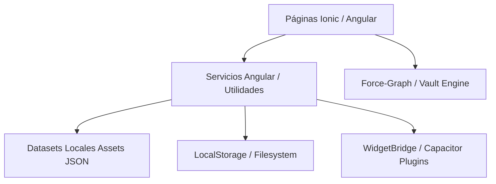

# PROJECT CONTEXT — LastResources (LastCodex)

## 1. Información General
- **Nombre del proyecto**: LastResources (LastCodex)
- **Objetivo**: Aplicación de pronóstico de materiales, gestión de gremios, consulta de códice, eventos de calendario y herramientas analíticas para la comunidad de jugadores del videojuego Orna.
- **Tipo de aplicación**: Multiplataforma (PWA / SPA con Ionic Angular, empaquetada como Desktop con Electron y Mobile con Capacitor para Android).
- **Usuarios principales**: Jugadores de Orna (miembros y líderes de reinos/gremios que optimizan rutas, materiales y equipamiento).
- **Estado actual del proyecto**: En producción activa / desarrollo continuo (versión 1.4.7).

## 2. Stack Tecnológico
- **Framework**: Angular 22.0.1 + Ionic Framework 9.0.0
- **Lenguaje**: TypeScript 6.0.0
- **UI Framework**: Ionic Angular (`@ionic/angular`) + SCSS personalizado + Ionicons 8.1.0
- **Backend**: Client-side puro (arquitectura offline-first / local data)
- **Base de datos**: Almacenamiento local mediante `localStorage` y datasets estáticos JSON (`codex-items.json`, `markers.json`, etc.).
- **Autenticación**: [NO DETERMINADO / NO APLICA] (Herramienta de consulta y utilidad client-side sin backend de autenticación obligatorio).
- **Storage**: Local Storage del navegador / WebView + Capacitor Filesystem (`@capacitor/filesystem`).
- **APIs externas**: Integraciones con datos de la comunidad Orna, exportación de imágenes con `html-to-image`, renderizado de vault markdown con `marked` y `force-graph`.
- **Hosting / Deployment**: Vercel (Web / PWA), Electron 44 / Electron Builder 26 (Windows x64 / portable), Capacitor 8 (Android APK).

## 3. Arquitectura
La aplicación opera como un cliente offline-first con soporte para múltiples runtimes (Web, Android vía Capacitor y Windows vía Electron). La lógica se divide en servicios desacoplados que leen datasets estáticos empaquetados en `assets/` y mantienen persistencia de configuraciones en `localStorage` o filesystem.

## 4. Estructura del Proyecto
- `src/app/pages/`: Vistas principales de la aplicación (Home, Codex, Codex-Classes, Calendar, Events, Towers, Proofs, Assess, Search, Map, Obsidian-Vault, Settings, Legal).
- `src/app/services/`: Capa de datos y lógica de negocio (`codex.service`, `materials.service`, `towers.service`, `notifications.service`, `vault.service`, etc.).
- `src/app/models/`: Definición de interfaces TypeScript (`material.model.ts`, `event.model.ts`, etc.).
- `src/app/tabs/`: Estructura de navegación principal por pestañas y enrutamiento jerárquico.
- `src/app/utils/`: Funciones auxiliares de cálculo, canvas (`forecast-canvas.util`), mapeo de iconos y traducción de materiales.
- `src/assets/`: Iconografía del juego, datos pesados (`data/codex-items.json`), mapas interactivos y recursos de gremios/materiales.
- `obsidian/`: Bóveda técnica local (`codex-vault`) sincronizada para visualización de grafos de conocimiento.
- `scripts/`: Scripts Node.js para generación de grafos (`generate-vault-graph.js`) y compilación de APKs (`build-apk.js`).
- `electron-main.js`: Proceso principal de Electron para empaquetado de escritorio Windows.

## 5. Rutas de la Aplicación
Todas las rutas operan en el cliente bajo el contenedor de tabs:
- `/home`: Pronóstico diario de materiales de gremios y accesos rápidos (Pública).
- `/search`: Búsqueda de materiales y fechas estimadas de aparición en tiendas/gremios (Pública).
- `/calendar`: Calendario mensual de eventos de Orna (Pública).
- `/towers`: Rastreo y utilidades de torres celestiales (Pública).
- `/codex`: Buscador y visualizador interactivo del códice de objetos, monstruos y equipo (Pública).
- `/codex/classes`: Listado y desglose de clases de personajes (Pública).
- `/events`: Listado detallado de eventos activos y recompensas (Pública).
- `/map`: Visor de mapa de marcadores comunitarios (Pública).
- `/proofs` (alias `/calculator`): Calculadora de pruebas y recursos requeridos (Pública).
- `/assess`: Evaluador / tasador de estadísticas y calidades de items (Pública).
- `/obsidian-vault`: Explorador de grafo de conocimiento y documentación técnica interna (Pública).
- `/settings`: Configuración de notificaciones, tema, idioma y preferencias (Pública).
- `/legal`: Términos de uso, privacidad y descargos de responsabilidad legal (Pública).

## 6. Modelo de Datos
- `GuildStock`: `guildName: string`, `materials: string[]`
- `DayForecast`: `dateTitle: string`, `guilds: GuildStock[]`
- `MaterialSearchResult`: `materialName: string`, `guildAppearances: MaterialGuildAppearance[]`
- `OrnaCalendarEvent`: `id: string`, `name: string`, `startDay: number`, `endDay: number`, `icon: string`, `color: string`, `descriptionEs: string`, `rewardsEs: string`, etc.
- `CalendarCell`: `dayNumber: number`, `isCurrentMonth: boolean`, `isToday: boolean`, `events: OrnaCalendarEvent[]`
- `CodexItem`: Modelo derivado de `codex-items.json` con metadatos de rareza, tier, tipo, bonificadores de stats y fuentes de obtención.

## 7. Autenticación y Autorización
- No requiere autenticación de usuarios remotos. Todos los módulos son accesibles de forma libre y local por cualquier usuario. No se manejan secretos de autenticación en el cliente.

## 8. Funcionalidades
- [IMPLEMENTADO] Pronóstico predictivo de materiales en rotación de gremios.
- [IMPLEMENTADO] Buscador avanzado de objetos en el códice con filtros por tier, tipo y bonificaciones.
- [IMPLEMENTADO] Visor interactivo de clases y habilidades.
- [IMPLEMENTADO] Calendario mensual de eventos y notificaciones locales (Capacitor Local Notifications).
- [IMPLEMENTADO] Calculadora de pruebas (Proofs) y tasador de calidad de ítems (Assess).
- [IMPLEMENTADO] Visor de grafo de notas Obsidian integrado con `force-graph`.
- [IMPLEMENTADO] Soporte de ejecutable de escritorio portátil para Windows y build Android APK.
- [EN PROGRESO] Optimización y sincronización de datos de la bóveda técnica.

## 9. Integraciones
- Capacitor Plugins: App, Filesystem, Haptics, Keyboard, Local Notifications, Share, Status Bar.
- Electron Builder: Generación de ejecutables portables e instaladores para Windows.
- Force Graph & Marked: Renderizado interactivo del grafo de conocimiento markdown.

## 10. Decisiones Técnicas Importantes
- **Decisión**: Arquitectura offline-first basada en activos estáticos JSON preempaquetados.
  - **Motivo**: Garantizar disponibilidad inmediata y rapidez para los jugadores sin requerir infraestructura backend costosa ni latencia de red.
- **Decisión**: Soporte triple objetivo de despliegue (Web, Electron, Capacitor) desde una única base de código Angular.
  - **Motivo**: Brindar versatilidad en dispositivos móviles y de escritorio maximizando la reutilización de lógica y componentes.

## 11. Problemas Conocidos
- El tamaño del archivo `codex-items.json` supera los 10MB, lo que requiere carga perezosa o lectura indexada para optimizar el consumo de memoria en dispositivos móviles de gama baja.

## 12. Dependencias Importantes
- `@angular/core` & `@ionic/angular`: Núcleo de la interfaz y reactividad.
- `force-graph`: Visualización interactiva en 2D/3D del grafo de la bóveda de conocimiento.
- `@capacitor/local-notifications`: Programación de alertas de gremios y recordatorios de eventos.
- `html-to-image`: Generación de capturas y reportes gráficos exportables.

## 13. Última Actualización
- **Fecha**: 2026-10-07
- **Cambios**: Inicialización oficial de la documentación técnica y mapeo arquitectónico inicial.
